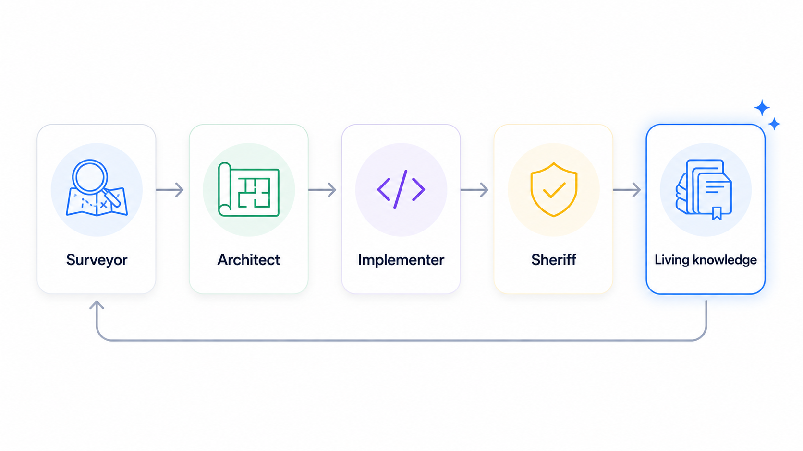

# Agent Settings

This repository holds reusable, project-specific guidance that helps coding agents produce more consistent and reliable changes.

The documentation-impact checker is a small example of the intended use. It maps code paths to the documentation they affect, then checks that a pull request explains whether those documents were updated or reviewed. The `apps/client` tree is deliberately dummy content so the example can run without exposing another project's implementation or business context.

The most useful additions to this repository are the things that are easy for an agent to miss: conventions, constraints, decision records, validation commands, and concise examples.

Start with [AGENTS.md](AGENTS.md). The [workflow evolution article](docs/development/implementation-workflow-evolution.md)
explains why explicit agent roles can become one adaptive implementation loop while keeping the
same responsibilities.
